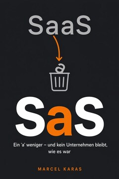

Wir entwickeln Apps, Plattformen und Individualsoftware, automatisieren Prozesse mit KI und betreiben skalierbare Cloud-Lösungen – auch unsere eigenen. Diese Betreiber-Erfahrung fließt in jedes Kundenprojekt.

**[jungherz.com](https://jungherz.com/)** · [Erstgespräch buchen](https://tidycal.com/jungherz/erstgespraech) · [Prozess-Sprint](https://jungherz.com/sprint/) · [Das Buch „SaS“](https://jungherz.com/service-as-software/) · [kontakt@jungherz.com](mailto:kontakt@jungherz.com)

| 60+ | 15 Jahre | < 24 h | 100 % |
|:---:|:---:|:---:|:---:|
| umgesetzte Projekte | Entwicklung & Beratung | Reaktionszeit im Support | Hosting in Deutschland |

## Wer wir sind

Die Jungherz GmbH aus Dorsten baut Software nicht nur – **wir betreiben und vermarkten sie selbst**. Wer eigene Produkte am Markt hält, plant Kundenprojekte anders: ehrlicher, robuster, langfristiger. Ihr Ansprechpartner ist [Marcel Karas](https://jungherz.com/marcel/), Geschäftsführer, seit 1997 in der IT und seit über 15 Jahren Unternehmer.

## Was wir tun

- **App- & Individualentwicklung:** Web- und Mobile-Apps, die zu Ihren Prozessen passen, nicht umgekehrt.
- **Baukasten-Systeme:** Wiederkehrendes als konfigurierbare Module. Neues entsteht in Wochen statt Monaten.
- **KI-Automatisierung:** vom Telefon-Assistenten bis zur Dokumenten- und Datenauswertung.
- **Cloud-Lösungen & Betrieb:** skalierbare Architekturen, von uns betrieben, gehostet in Deutschland.

**Der Einstieg: der Prozess-Sprint.** In 10 Arbeitstagen vom Engpass zum klickbaren Prototyp. Festpreis ab 2.900 € netto, bei Beauftragung der Umsetzung innerhalb von 60 Tagen voll angerechnet. [So läuft der Sprint ab →](https://jungherz.com/sprint/)

## Unsere Produkte

Vier eigene SaaS-Lösungen laufen bei uns im Echtbetrieb, mit allem, was dazugehört: Skalierung, Support, Vermarktung.

| Produkt | Was es tut |
|---|---|
| [**AppConfector**](https://www.appconfector.de/) | Der App-Baukasten für den Mittelstand: Kommunikation, Präsentation und Verkauf aus einem System. |
| [**EhrenPfoten**](https://ehrenpfoten.app/) | Ehrenamt im Tierheim, einfach organisiert: Ehrenamtliche buchen Gassigänge per App, das Team plant Zeitfenster und Freigaben an einem Ort. |
| [**MonaHilft**](https://www.monahilft.de/) | KI-Telefonassistenz, die ein- und ausgehende Gespräche intelligent und natürlich wirkend übernimmt. |
| [**StripeJack**](https://stripe-jack.cloud/) | Stripe-Umsätze als DATEV-Buchungsstapel: gehostet, monatlich automatisch und ohne Transaktionslimit, verarbeitet in Deutschland. |

## Das Buch

**SaS – Ein ‚a‘ weniger – und kein Unternehmen bleibt, wie es war** von Marcel Karas, erschienen im Oktober 2026. Aus Software-as-a-Service wird Service-as-Software: Unternehmen kaufen in Zukunft keine Software mehr, sie kaufen Ergebnisse. Ein Leitfaden für Verantwortliche, mit HITL-Stufenmodell, 90-Tage-Plan und einer echten Fallstudie aus einem Planungsbüro.

[Zum Buch](https://jungherz.com/service-as-software/) · [Kostenlose Toolbox](https://service-as.software/toolbox/)

 

## Open Source

Unsere Arbeit ist einsehbar: Werkzeuge, die wir für uns bauen, veröffentlichen wir, wo es geht. Die Website jungherz.com läuft selbst auf GlassKit.

| Repository | Beschreibung | Stack | Lizenz |
|---|---|---|---|
| [**GlassKit**](https://github.com/JUNGHERZ/GlassKit) | Glassmorphism-CSS-Komponentenbibliothek (iOS-26-Liquid-Glass-Look): 24 Komponenten, Dark & Light Mode, Design Tokens – ohne Abhängigkeiten | CSS / HTML | MIT |
| [**GlassKit-Elements**](https://github.com/JUNGHERZ/GlassKit-Elements) | Vanilla-JS-Web-Components für GlassKit: Shadow DOM, native Form-Integration, 27 Komponenten | JavaScript | MIT |
| [**GlassKit-Web**](https://github.com/JUNGHERZ/GlassKit-Web) | Astro-Template in der GlassKit-Designsprache: zweisprachig, SEO, No-JS-Fallbacks | Astro | MIT |
| [**NotionKit**](https://github.com/JUNGHERZ/NotionKit) | Der ruhige Notion-Look als CSS-Designsystem: ~100 Komponenten, Light & Dark Mode, Design Tokens, Editor-Adapter (TipTap/BlockNote/Novel) – ohne JavaScript, ohne Build-Step | CSS / HTML | MIT |
| [**NotionKit-Elements**](https://github.com/JUNGHERZ/NotionKit-Elements) | 68 Vanilla-JS-Web-Components (`<nk-*>`) für NotionKit: Shadow DOM, native Form-Integration, pixelgenau zur Klassen-Variante | JavaScript | MIT |
| [**NotionKit-Web**](https://github.com/JUNGHERZ/NotionKit-Web) | Astro-Template für komplette Websites im Notion-Look: Doku, Wissensdatenbank, Blog – zweisprachig, getestet, ohne externe Requests | Astro | MIT |
| [**Voice-Office-Hub**](https://github.com/JUNGHERZ/Voice-Office-Hub) | Self-hosted KI-Telefonie-Appliance (Asterisk + Deepgram): annehmen, führen, übergeben, transkribieren – DSGVO-freundlich, ein Docker-Container | TypeScript | CC BY-NC 4.0 |
| [**MakeMyGame**](https://github.com/JUNGHERZ/MakeMyGame) | Spielidee beschreiben – die KI baut ein spielbares Retro-Game im Gameboy- oder SNES-Stil | JavaScript | MIT |
| [**StripeJack**](https://github.com/JUNGHERZ/StripeJack) | Stripe-Transaktionen nach DATEV exportieren: EXTF-Buchungsstapel, Belegarchiv, Erlösabgrenzung – läuft lokal; gehostet als StripeJack.cloud | TypeScript | MIT |
| [**md2webui**](https://github.com/JUNGHERZ/md2webui) | Markdown-Chatlogs (ChatGPT-Exporte) in das JSON-Importformat von Open WebUI konvertieren | Python | – |
| [**eps2svg**](https://github.com/JUNGHERZ/eps2svg) | Adobe-Illustrator-EPS nach SVG konvertieren – mit nativen Verläufen und korrekten CMYK-Farben | Python | MIT |

## Kontakt

Erzählen Sie uns von Ihrem Projekt. Wir melden uns mit einer ehrlichen Einschätzung.

- Website: [jungherz.com](https://jungherz.com/)
- Erstgespräch: [tidycal.com/jungherz/erstgespraech](https://tidycal.com/jungherz/erstgespraech) (30 Minuten, unverbindlich)
- E-Mail: [kontakt@jungherz.com](mailto:kontakt@jungherz.com)
- LinkedIn: [Marcel Karas](https://www.linkedin.com/in/marcel-karas-de/)

**In English:** We build apps, platforms and custom software, automate processes with AI and run scalable cloud solutions – including our own products. [jungherz.com/en →](https://jungherz.com/en/)

Jungherz GmbH · Dorsten, Deutschland · [Impressum](https://jungherz.com/impressum/)
